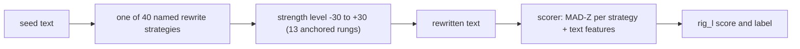

# RIG Deviate

Forty named ways to rewrite a draft, at thirteen strength settings, plus a scorer that
reports how far the result sits from generic AI writing. Made for writers and teams who
want drafts that say something specific, with a number to back it up.

[](https://github.com/mrodgersjs-web/rig-deviate/actions/workflows/ci.yml)
[](LICENSE)
[](https://www.python.org/downloads/)

## Why this exists

Model drafts drift toward the same safe, vague phrasing. This library gives you named
rewrite strategies that push a draft in a deliberate direction, and a deterministic
score that says how generic the result still is. There are no model calls and no
network access: the same input always produces the same output.

## Quickstart

```bash
git clone https://github.com/mrodgersjs-web/rig-deviate.git
cd rig-deviate
python3 -m venv .venv && . .venv/bin/activate
pip install -e '.[dev]'
python -c "from rig_deviate import deviate, score; r=deviate('Our product helps teams collaborate better.','GRAVITON',10); print(r); print(score(r)['rig_l'], score(r)['rig_l_label'])"
```

Real output of the last command:

```
Our product helps teams collaborate better. (quantified: 3.7× above baseline, n=12).
3.2 marginal
```

## Usage

```python
from rig_deviate import deviate, deviate_all, score

seed = "Our product helps teams collaborate better."

# one strategy at a chosen strength level (-30 to +30)
result = deviate(seed, "GRAVITON", 10)

# every strategy at once
all_results = deviate_all(seed, 5)
print(len(all_results))  # 40

# how generic is the result?
report = score(result)
print(report["rig_l"], report["rig_l_label"])  # 3.2 marginal
```

## How it works



- **Strength levels.** `SIGMA_RUNGS` anchors 13 levels: -30, -20, -10, -5, -3, -1, 0,
  1, 3, 5, 10, 20, 30. Zero is the neutral pass. Positive levels push the text away
  from generic phrasing; negative levels pull it back toward it. Cognitive and nature
  strategies use a soft +/-20 range; the 10 physics strategies are hard state gates at
  +/-30.
- **The scorer** measures each strategy's signal in the text (robust MAD-Z against a
  generic baseline) plus surface features like mechanism density, and folds them into
  one `rig_l` number with a plain label.

## What it proves

- `pytest -q` runs 40-strategy sweeps, clamping and error paths, the 13-rung ladder
  truth, scorer output shape, and determinism checks.
- `python examples/rewrite_and_score.py` prints a rewrite and its score, end to end.
- `rig-deviate engines` lists all 40 strategies and their strength ranges.

## Project layout

```
rig_deviate/engines.py   the 40 strategies and the strength ladder
rig_deviate/score.py     MAD-Z scorer and rig_l grading
test/                    pytest suite
examples/                runnable rewrite-and-score walkthrough
docs/                    architecture notes
```

## Development

```bash
pip install -e '.[dev]'
ruff check .
pytest -q --cov
```

## Contributing, security, license

See [CONTRIBUTING.md](CONTRIBUTING.md), [SECURITY.md](SECURITY.md), and the
[MIT license](LICENSE).

Built by Mike Rodgers · rodgersintelligence.com
