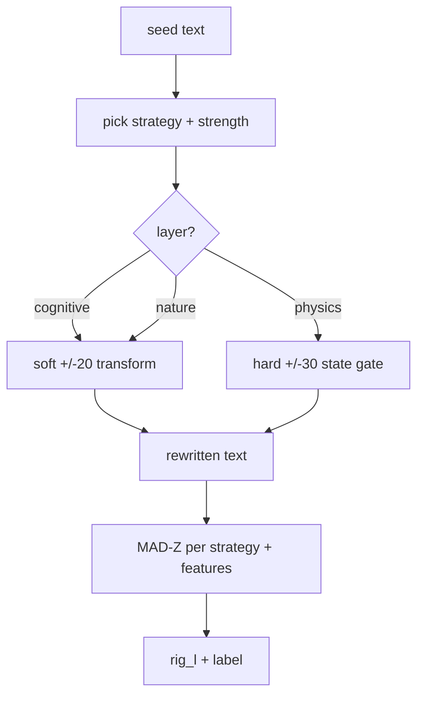

# Architecture

## Two halves

1. **Rewrite strategies** (`rig_deviate/engines.py`): 40 named strategies in three
   layers (20 cognitive, 10 nature, 10 physics). Each takes a text and a strength
   level and returns a rewritten text. All transforms are deterministic: regex,
   token and sentence work only, no model calls.
2. **Scorer** (`rig_deviate/score.py`): measures each strategy's signal in a text as
   a robust MAD-Z against a generic-text baseline, folds in surface features such as
   mechanism density, and returns one `rig_l` number with a label.

## The strength ladder

`SIGMA_RUNGS` anchors 13 levels: (-30, -20, -10, -5, -3, -1, 0, 1, 3, 5, 10, 20, 30).
Levels outside the rungs are clamped to +/-30. Zero is a neutral pass-through.
Positive levels push away from generic phrasing; negative levels pull toward it.

- Cognitive and nature strategies treat the range as a soft +/-20 scale.
- The 10 physics strategies are hard state gates at +/-30: the negative pole blocks
  rather than nudges.

## Determinism

Everything is pure text processing over fixed word lists and regexes. The same input
always produces the same output, which is what makes the tests able to assert exact
values and what makes the score comparable across runs.
